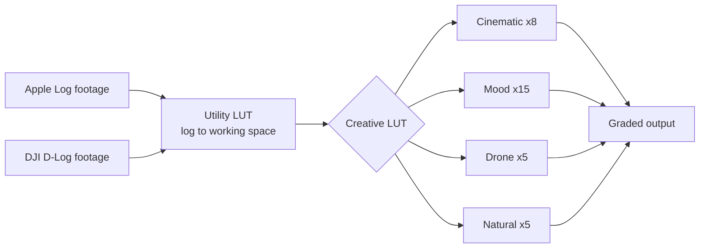
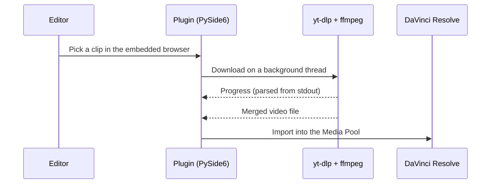

# altn

A colour grading suite for trekking and drone footage: **35 self-authored LUTs** for DaVinci Resolve, the website that ships them, and a Resolve plugin that pulls YouTube reference clips straight into the Media Pool.

## What's inside

| Part | Folder | Stack |
|---|---|---|
| LUT pack: 33 creative and 2 utility LUTs, 65-point grid | `luts/`, `utility/` | `.cube` files generated with Python |
| Website (built for `altn.studio`) | `site/` | Astro 5, React islands, Tailwind CSS v4 |
| Experimental site variant | `site_pro/` | Same stack, plus Motion animations |
| YouTube media downloader for DaVinci Resolve | `Davinci_plugins/` | Python, PySide6, yt-dlp, ffmpeg |
| Planning docs (PRD, architecture, phases, research) | `things/` | Markdown |

The redesigned site lives on in [AltnWeb2](https://github.com/AaryanRaj007/AltnWeb2).

## How the LUTs work

Each grade is built in two layers. A normalisation step converts the camera's log curve to a common working space, and the creative look is applied on top. One creative LUT then works across cameras.



The 65-point grid, rather than the usual 33, avoids banding in skies and smooth gradients on 10-bit log footage.

| Collection | Count | Use it for |
|---|---|---|
| Cinematic | 8 | Film-style contrast and colour separation |
| Mood | 15 | Strong stylised looks |
| Drone | 5 | Aerials: haze, skies, wide landscapes |
| Natural | 5 | Clean, true-to-life correction |
| Utility | 2 | Log normalisation, applied first |

## Website

Static site with zero JavaScript by default. React hydrates only the interactive parts: the LUT gallery and the before/after slider, which is a native range input plus a CSS `clip-path`. "Download all" builds the ZIP in the browser with `jszip`, so there's no backend and hosting is free on Cloudflare Pages.

```bash
cd site
npm install
npm run dev       # http://localhost:4321
npm run build     # static output in dist/
```

## DaVinci Resolve plugin

A dark-themed PySide6 window that floats above Resolve, with an embedded browser for finding clips. Downloads run on a background `QThread` through `yt-dlp`, with live progress parsed from its output. Finished files are imported into the Media Pool through the Resolve scripting API.



It needs `yt-dlp` and `ffmpeg`, either on `PATH` or bundled. The GitHub Actions workflow in `.github/workflows/build-windows-exe.yml` builds the Windows installer, and the macOS installer is built with PyInstaller from the `.spec` files in `Davinci_plugins/YouTubeDownloader/`.

## Licence

[MIT](LICENSE)
